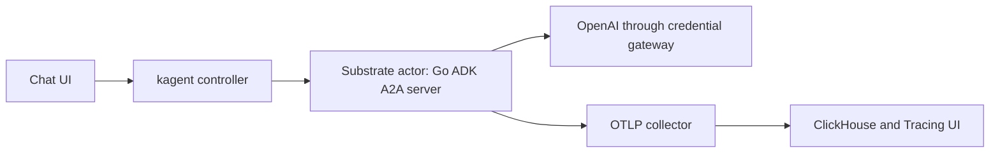

# Trace-enabled Go ADK agent

This demo builds a programmatic Go ADK agent and runs it through a `kagent: {}` Harness on Agent Substrate. A model call produces a GenAI span; asking it to add two integers also exercises a function tool. The A2A server uses kagent's executor to flush spans before Substrate suspends the actor. The model credential stays in the existing `default-model-config` Secret and is injected into outbound requests by the Substrate egress gateway, not baked into the image.

## Architecture



The controller compiles the `AgentTemplate` and the runtime settings into the actor's `KAGENT_CONFIG_JSON`: the model, system prompt and MCP tools, plus the agent's name and namespace, the control-plane URL, the listen port and the telemetry endpoint. `main.go` reads that config, builds the ADK agent itself so it can add the `add_numbers` tool, and serves private A2A on the compiled port with `GET /readyz` on port 8081.

The `AgentTemplate` references `default-model-config`, which lets the controller authorize OpenAI egress and inject the referenced Secret as a destination-scoped header. `MODEL_NAME` in the Harness must match that ModelConfig. ADK sessions live in the actor's durable directory, so they survive suspend, resume and actor replacement.

## Prerequisites

- A Kubernetes cluster with `kagent-enterprise` `1.0.0-alpha11`, substrate-enterprise `0.5.0-alpha4-da3c2e5`, and a ready `kagent/kagent-default` WorkerPool. The Go module pins the matching kagent `v1.0.0-alpha14` API.
- The kagent telemetry collector enabled, and the runtime trace endpoint set on the kagent-enterprise chart. The agent refuses to start without it:

  ```yaml
  telemetry:
    enabled: true
  config:
    runtimeDefaults:
      telemetry:
        traces:
          endpoint: http://solo-enterprise-telemetry-collector.kagent.svc.cluster.local:4317
  ```

- A Substrate snapshot location. `agent.yaml` uses `gs://ate-snapshots/kagent/adk-trace-enabled/`. Substrate writes snapshots to the storage backend it was installed with, which is the bundled RustFS (S3) by default; the `gs://` scheme does not switch it to GCS.
- `kagent/default-model-config` using OpenAI `gpt-4.1-mini`, referencing a populated Secret. The Secret value is not passed in the Harness environment.
- A container registry that the Substrate workers (`atelet`) can pull from. They pull actor images themselves, so pod `imagePullSecrets` do not apply.
- Go 1.27, Docker with buildx, `envsubst`, and `kubectl`. Log Docker in to your registry before pushing.

## Quickstart

From this directory, set your registry and build:

```sh
export IMAGE_REPOSITORY=<your-registry>/<your-repo>/adktraceenabled
make test
make build
make push
```

`make push` prints the pushed digest. Substrate requires a digest-pinned image, so set `spec.workload.image` in `agent.yaml` to `${IMAGE_REPOSITORY}@sha256:<digest>`, replacing `YOUR_IMAGE_NAME_AND_REGISTRY_URL`. Alternatively, render a manifest from the template:

```sh
make render IMAGE=${IMAGE_REPOSITORY}@sha256:<digest> \
  SNAPSHOT_LOCATION=gs://ate-snapshots/kagent/adk-trace-enabled/ > agent.yaml
```

Deploy and wait for the golden snapshot:

```sh
make deploy
kubectl wait agents.api.kagent.dev/adk-trace-enabled -n kagent --for=condition=Ready --timeout=10m
```

The `Ready` condition must say `ActorTemplate golden snapshot is ready`. Open `adk-trace-enabled` in the UI and ask **"Add 17 and 25 using add_numbers."** The trace should contain the agent invocation, model calls and a tool execution. Check the stored span names if the UI does not show them:

```sh
kubectl exec -n kagent kagent-clickhouse-shard0-0 -- clickhouse-client --query \
  "SELECT SpanName, count() FROM kagent.otel_traces_json WHERE ServiceName = 'adk-trace-enabled' AND Timestamp > now() - INTERVAL 30 MINUTE GROUP BY SpanName ORDER BY SpanName"
```

A successful turn returns 42 and stores `invoke_agent adk_trace_enabled`, two `generate_content gpt-4.1-mini` model spans and `execute_tool add_numbers`. The first model span's Output is the `add_numbers` tool call; the second's Input includes the tool result and its Output is the final answer. The collector can only display spans the ADK runtime emits; the store query separates an exporter problem from a UI problem.

If the Agent reports `GoldenActorCrashed`, the runtime exited before serving `/readyz`. The usual causes are a missing runtime trace endpoint (see Prerequisites) or an image built against a different kagent release than the cluster runs.

This demo records prompts and responses. The Harness sets `OTEL_INSTRUMENTATION_GENAI_CAPTURE_MESSAGE_CONTENT=SPAN_ONLY`, and the Go ADK then adds `gen_ai.input.messages` and `gen_ai.output.messages` to each `generate_content` span. The tracing UI shows those as the model call's Input and Output. The chart's `config.runtimeDefaults.telemetry.captureContent` alone does not do this for a `kagent: {}` Harness: kagent compiles it into the runtime config but does not set the variable the Go ADK reads, and the ADK reads a plain `true` as log events only.

Content capture stores user and model content in your trace backend. To turn it off, remove that entry from `spec.env` in `agent.yaml` and apply it again. Either way, the change prepares a new revision: conversations started before it keep the old setting. The `invoke_agent` span carries no Input or Output, and the `add_numbers` span records its arguments and result as `gcp.vertex.agent.tool_call_args` and `gcp.vertex.agent.tool_response`. Do not set the controller's other `OTEL_*` settings, such as the exporter endpoint, in `Harness.spec.env`; the controller compiles those itself.

## Project Structure

- `main.go`: reads the compiled config, then wires the Go ADK model, the `add_numbers` tool, the A2A server, tracing initialization and pre-response flush.
- `agent.yaml`: deployable Harness, AgentTemplate and Agent. Replace the image placeholder with your digest-pinned image.
- `agent.yaml.tmpl`: source for `make render`, with `IMAGE`, `SNAPSHOT_LOCATION` and `MODEL_NAME` placeholders.
- `Dockerfile`: static Linux image built with Go 1.27.
- `Makefile`: `setup`, `test`, `build`, `push`, `render`, `deploy`, and `clean` targets.

`make clean` removes this demo's Harness, AgentTemplate and Agent. It does not remove the image, shared ModelConfig, WorkerPool, or Substrate release. kagent can garbage-collect snapshots after the resources are removed; check for conversations that still use this runtime before cleaning up.
